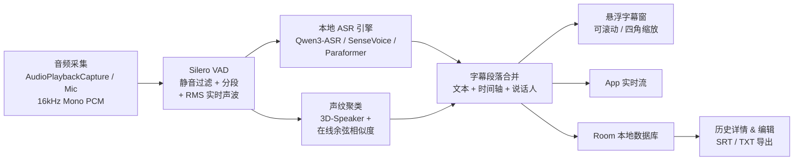

# Android Local Live Caption（安卓本地实时字幕）

[-3DDC84?logo=android&logoColor=white)](https://developer.android.com/)
[](https://kotlinlang.org/)
[](https://developer.android.com/jetpack/compose)
[](https://github.com/k2-fsa/sherpa-onnx)

一款 **100% 本地离线运行** 的安卓实时字幕与语音转录工具。基于 [`sherpa-onnx`](https://github.com/k2-fsa/sherpa-onnx) 端侧推理引擎，无需联网、无需云端 API、保护隐私，支持直接捕获手机内录媒体音频与外部麦克风声音，以可缩放、可滚动的悬浮字幕窗实时呈现，并支持说话人区分、历史记录管理与 SRT / TXT 导出。

---

## 核心功能

- **双音源实时采集**
  - **手机内录（`AudioPlaybackCapture`）**：基于 Android 10+ `MediaProjection`，直接转写手机正在播放的视频、网课、播客、直播与线上会议声音。
  - **麦克风收音**：直接采集外部环境人声，适用于线下会议、课堂、面对面访谈，主界面一键切换。
- **多款离线 ASR 模型（应用内一键下载 / 本地导入）**
  - 支持在应用内直接下载或从本地导入模型包，下载与 `.tar.bz2` / `.zip` 解压在应用级后台运行，切换页面不中断，实时展示下载、解压与校验进度。
- **说话人区分（Speaker Diarization）**
  - 结合 **Silero VAD** 自动断句 + **3D-Speaker (ERES2Net)** 声纹向量提取与在线余弦聚类，为每段字幕实时标记不同颜色的说话人标签（`说话人 1`、`说话人 2`…），支持在历史详情页一键批量重命名说话人。
- **可缩放、可滚动悬浮字幕窗**
  - 固定紧凑高度，新字幕出现时不会反复跳动遮挡视频画面；
  - 内部支持上下滚动回看最近 50 条字幕，处于底部时自动跟随最新一句；
  - 支持**四角自由拖拽缩放**与标题栏拖拽定位，支持一键锁定防误触、自定义字号与背景透明度。
- **可靠的收音与收尾体验**
  - 启动时预热加载本地模型并展示明确加载信号；
  - 主界面与悬浮窗均内置实时 RMS 声波指示条，一眼确认音频输入状态；
  - 点击停止后自动等待所有已缓存音频及 VAD 尾音识别落库完成，绝不截断最后一句；在主界面停止时会弹出「保存本次录音档案」命名窗，在悬浮窗/快捷开关停止时则自动按默认名静默保存。
- **快捷入口与系统集成**
  - **状态栏下拉快捷磁贴（Quick Settings Tile）**：在系统控制中心添加「实时字幕」磁贴，一键启停。
  - **桌面长按快捷方式（App Shortcuts）**：长按应用图标直接唤起悬浮字幕。
  - **Material You 动态主题色**：Android 12+ 自动跟随系统壁纸主题色，深浅色模式自适应。
  - **权限与后台保活引导**：设置页集成悬浮窗授权、忽略电池优化白名单与国产 ROM 后台锁定指引，并支持切换 **CPU / NNAPI（实验性 NPU）** 推理后端。
- **历史记录与导出分享**
  - Room 本地数据库持久化每次转录会话、时间戳、说话人与全文；
  - 支持标题检索、单条字幕编辑纠错、整场说话人重命名，以及标准 `.srt` / `.txt` 导出与系统分享。

---

## 支持的离线模型对比

所有模型均可在 App 内 **「模型管理」** 页面一键下载或手动导入：

| 模型 | 约占空间 | 特点与延迟 | 推荐场景 |
| :--- | :--- | :--- | :--- |
| **Paraformer-zh Small (INT8)** | ~80 MB | 非自回归中英双语，**单句 < 0.1 秒** | 中文为主、夹杂英文的视频/会议，追求极致实时性 |
| **SenseVoice Small (INT8)** *(推荐)* | ~238 MB | 非自回归多语种（中/英/日/韩/粤），**单句 ~0.1–0.3 秒** | 速度与准确率最均衡的日常主力模型 |
| **Qwen3-ASR 0.6B (INT8)** | ~839 MB | 自回归语音大模型，标点与复杂语境理解更强 | 对准确率要求高、可接受 1.5–4 秒单句延迟的场景 |
| **Silero VAD** *(辅助)* | ~2 MB | 精准语音端点检测与断句 | 建议安装，提升断句准确度与省电表现 |
| **3D-Speaker (ERES2Net)** *(辅助)* | ~40 MB | 端侧声纹向量提取 | 开启「说话人分离」功能时安装 |

> **提速小贴士**：在「设置 → 语音识别」中将**推理线程数**调至 `4`（适配主流 8 核手机大核），可显著降低识别延迟。

---

## 系统流水线架构



---

## 从源码构建

### 环境要求
- Android Studio（推荐 Ladybug 及以上）或 JDK 17 / 21
- Android SDK 35（`minSdk = 29`，目标 ABI：`arm64-v8a`）
- Gradle 8.14

### 1. 克隆仓库

```bash
git clone https://github.com/SaitoTommo/Android_Local_Live_Caption.git
cd Android_Local_Live_Caption
```

### 2. 下载 `sherpa-onnx` Android AAR（启用端侧推理必需）

为保持 Git 仓库轻量，预编译的原生二进制包未提交至仓库。请从 [k2-fsa/sherpa-onnx Releases](https://github.com/k2-fsa/sherpa-onnx/releases) 下载对应版本的 Android AAR（例如 `sherpa-onnx-2.0.2.aar`），并放入 `app/libs/` 目录：

```text
app/libs/sherpa-onnx-2.0.2.aar
```

> 注：本项目通过反射桥接层 [`SherpaOnnxBridge.kt`](app/src/main/java/com/localcaption/app/asr/SherpaOnnxBridge.kt) 与原生库解耦，即使暂未放入 AAR 也可直接编译查看 UI，但只有在放入 AAR 后才会启用离线识别、Silero VAD 与说话人分离能力。

### 3. 编译与运行测试

使用 **Android Studio** 直接打开项目同步并运行，或通过命令行构建：

```bash
# 运行 JVM 单元测试
gradle :app:testDebugUnitTest

# 构建 Debug APK
gradle :app:assembleDebug
```

构建产物位于：`app/build/outputs/apk/debug/app-debug.apk`。

---

## 项目目录结构

```text
├── settings.gradle.kts
├── build.gradle.kts
├── gradle.properties
├── gradle/libs.versions.toml
└── app/
    ├── build.gradle.kts
    ├── proguard-rules.pro
    ├── libs/                       # 放置 sherpa-onnx-*.aar（已被 .gitignore 忽略）
    └── src/
        ├── main/
        │   ├── AndroidManifest.xml
        │   ├── res/                # 矢量图标、shortcuts.xml、file_paths.xml、主题与字符串
        │   └── java/com/localcaption/app/
        │       ├── LocalCaptionApp.kt
        │       ├── MainActivity.kt
        │       ├── data/           # Room 数据库、DataStore 设置、Repository
        │       ├── audio/          # PlaybackAudioCapture、MicAudioCapture
        │       ├── asr/            # SherpaOnnxBridge、AsrEngine、VadSegmenter、SpeakerDiarizer、ModelManager、TranscriptionPipeline
        │       ├── service/        # CaptionForegroundService、FloatingOverlayManager、CaptionTileService
        │       ├── export/         # SrtExporter、TxtExporter、ExportHelper
        │       └── ui/             # Jetpack Compose Material 3 界面
        └── test/                   # 单元测试（SRT/TXT 导出、在线说话人聚类、VAD 切段）
```

---

## 权限说明

- `RECORD_AUDIO`：麦克风收音及系统内录音频采集所需。
- `FOREGROUND_SERVICE` / `FOREGROUND_SERVICE_MEDIA_PROJECTION` / `FOREGROUND_SERVICE_MICROPHONE`：切换至其他 App 时保持后台实时转录不断开。
- `SYSTEM_ALERT_WINDOW`：在其他应用上方显示悬浮字幕窗。
- `POST_NOTIFICATIONS`：显示前台服务常驻通知与快捷停止按钮（Android 13+）。
- `REQUEST_IGNORE_BATTERY_OPTIMIZATIONS`：引导将应用加入电池优化白名单，降低后台被系统清理的概率。
- `INTERNET`：仅用于在「模型管理」页从 GitHub Releases 下载离线模型文件；模型安装完成后可完全断网使用。

> 注：受 Android 系统安全策略限制，极少数声明禁止音频捕获（`allowAudioPlaybackCapture="false"`）的 DRM 受保护应用无法被系统内录，此时可一键切换至「麦克风收音」模式。

---

## 致谢

- [k2-fsa/sherpa-onnx](https://github.com/k2-fsa/sherpa-onnx) — 优秀的跨平台端侧离线语音推理框架
- [Qwen3-ASR](https://github.com/QwenLM/Qwen3-ASR) / [SenseVoice](https://github.com/FunAudioLLM/SenseVoice) / [FunASR Paraformer](https://github.com/modelscope/FunASR) / [Silero VAD](https://github.com/snakers4/silero-vad) / [3D-Speaker](https://github.com/modelscope/3D-Speaker)
